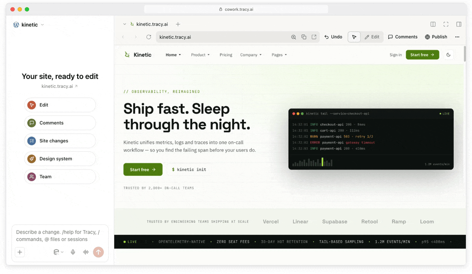
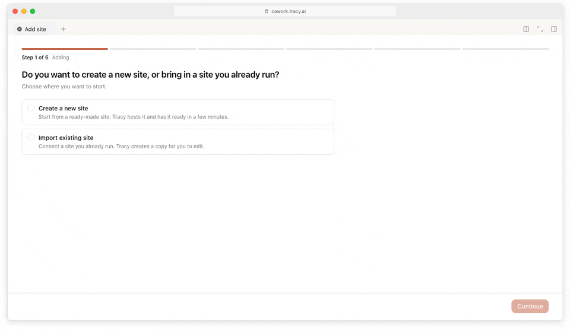
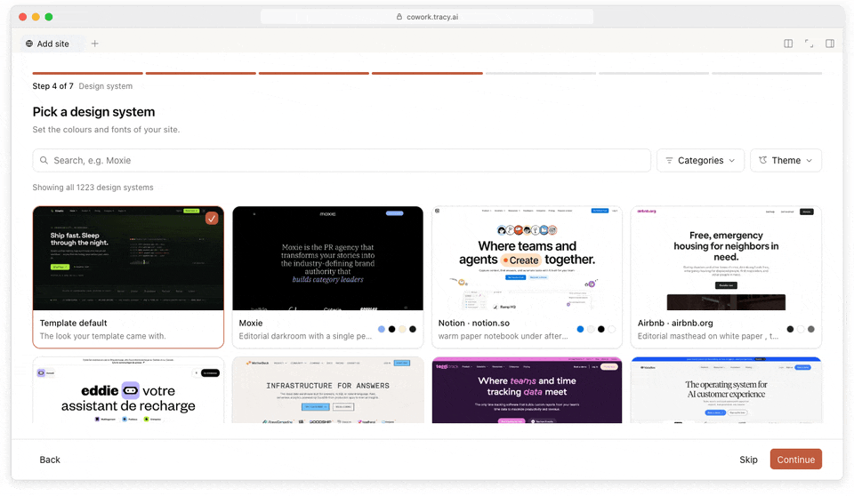
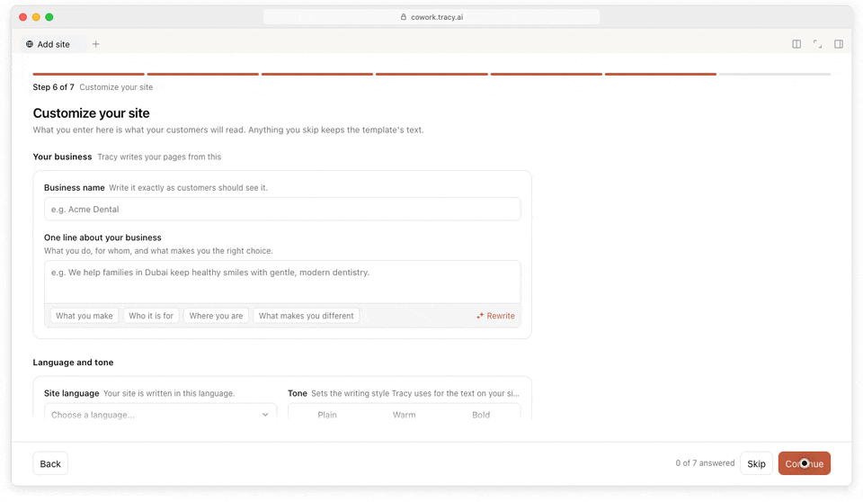
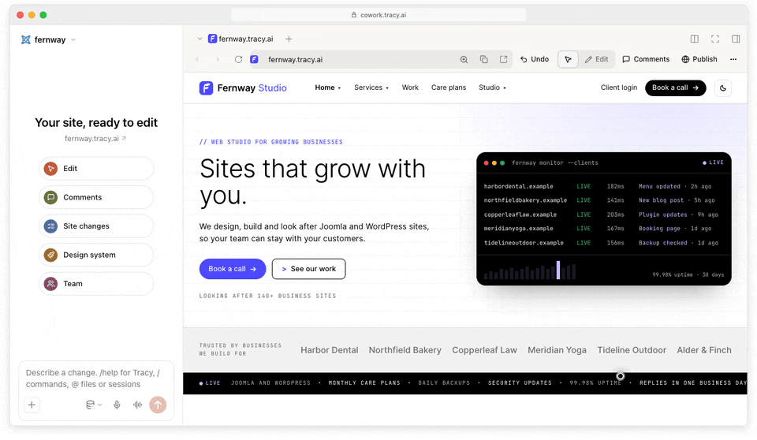

<h1 align="center">
  <a href="https://tracy.ai"></a> Tracy
</h1>

<p align="center">
  
  
  
  <a href="https://discord.gg/BM9TMRcEBb"></a>
  <a href="https://x.com/tracydotai"></a>
</p>

<p align="center">
  <sub><strong>English</strong> · <a href="docs/readme/README.de.md">Deutsch</a> · <a href="docs/readme/README.it.md">Italiano</a> · <a href="docs/readme/README.fr.md">Français</a> · <a href="docs/readme/README.nl.md">Nederlands</a> · <a href="docs/readme/README.zh.md">中文</a> · <a href="docs/readme/README.vi.md">Tiếng Việt</a> · <a href="docs/readme/README.es.md">Español</a></sub>
</p>

<p align="center">
  <strong>A faster way to run your website on the CMS you already trust.</strong><br/>
  Tell Tracy what you want in one sentence. Its AI agent edits the real site, and every change can be reviewed and undone.
</p>

<h3 align="center"><a href="https://cowork.tracy.ai"><ins>Try Tracy free</ins></a> · <a href="https://tracy.ai/download/"><ins>Download the app</ins></a></h3>

<p align="center">
  <picture>
    <source media="(prefers-color-scheme: dark)" srcset="docs/assets/readme/edit-dark.gif" />
    
  </picture><br/>
  <sub><strong>Click, ask, done.</strong> Click any block on your live site, say what you want, and review the result. <a href="https://tracy.ai/help/chatting-with-tracy/">Help →</a></sub>
</p>

## Features

<table>
<tr>
<td width="50%" valign="middle">

### Bring the site you have

Enter the address of a WordPress, Joomla or EmDash site you already run. Tracy checks it can reach it,
brings it in, and you edit it like any other site.

[Help →](https://tracy.ai/help/import-site/)

</td>
<td width="50%">
  <a href="https://tracy.ai/help/import-site/"><picture><source media="(prefers-color-scheme: dark)" srcset="docs/assets/readme/import-dark.gif" /></picture></a>
</td>
</tr>
<tr>
<td width="50%" valign="middle">

### Start from free templates

Choose WordPress, Joomla or EmDash, then pick a starting design from a large library of free
templates. Ask for changes in a sentence and publish — no blank page to fill.

[Browse templates →](https://cowork.tracy.ai/design-inspiration)

</td>
<td width="50%">
  <a href="https://cowork.tracy.ai/design-inspiration"><picture><source media="(prefers-color-scheme: dark)" srcset="docs/assets/readme/template-dark.gif" /></picture></a>
</td>
</tr>
<tr>
<td width="50%" valign="middle">

### Restyle from 1,200+ styles

Browse more than 1,200 styles, preview each one on your own site in light, dark and mobile, and apply
the one you like to the whole site at once.

[Help →](https://tracy.ai/help/design-templates-and-brand/)

</td>
<td width="50%">
  <a href="https://tracy.ai/help/design-templates-and-brand/"><picture><source media="(prefers-color-scheme: dark)" srcset="docs/assets/readme/design-system-dark.gif" /></picture></a>
</td>
</tr>
<tr>
<td width="50%" valign="middle">

### Turn your brief into a site

Describe your business in a line, pick a language and a tone, add your logo. Tracy writes your pages
from it and hands you a working site at its own address.

[Help →](https://tracy.ai/help/create-a-new-site/)

</td>
<td width="50%">
  <a href="https://tracy.ai/help/create-a-new-site/"><picture><source media="(prefers-color-scheme: dark)" srcset="docs/assets/readme/brand-dark.gif" /></picture></a>
</td>
</tr>
<tr>
<td width="50%" valign="middle">

### Go live anytime

Publish when you are ready and connect a domain you own. Tracy shows the DNS records to add and
keeps the site on HTTPS.

[Help →](https://tracy.ai/help/publish-and-go-live/)

</td>
<td width="50%">
  <a href="https://tracy.ai/help/publish-and-go-live/"><picture><source media="(prefers-color-scheme: dark)" srcset="docs/assets/readme/publish-dark.gif" /></picture></a>
</td>
</tr>
</table>

**Also in the box:**

- **[Site changes](https://tracy.ai/help/site-changes-and-diffs/)** — Every change in one list: who made it, where it came from (a chat, a comment, the site's own admin, a deploy) and a diff of exactly what moved.
- **[Undo and backups](https://tracy.ai/help/rollback-and-releases/)** — Undo one request at a time, or restore the whole site from a backup.
- **[Teams and roles](https://tracy.ai/help/team-roles-and-invitations/)** — Invite people per site with their own role; built for agencies that look after many client sites.
- **[Comments](https://tracy.ai/help/comments-and-notes/)** — Leave a note on any block for a teammate, or turn it into a request for Tracy.
- **[Your own AI account](https://tracy.ai/help/ai-accounts-and-models/)** — Tracy AI is included; you can also connect an AI account you already pay for.
- **[MCP and API](https://docs.tracy.ai/mcp/getting-started/)** — Drive Tracy from your own agent or scripts.
- **[Eight interface languages](https://tracy.ai/help/settings-and-languages/)** — English · Deutsch · Italiano · Français · Nederlands · 中文 · Tiếng Việt · Español.

---

## Install

- **Web app:** open **[cowork.tracy.ai](https://cowork.tracy.ai)** — nothing to install.
- **Desktop app (macOS, Windows, Linux):** **[Download from tracy.ai](https://tracy.ai/download/)**. It shows the same
  pages as the web app and adds what only a desktop app can do, such as saving files on your computer.

Tracy is in beta and free to use while it is.

---

## Community & Support

- **Discord:** join the community on **[Discord](https://discord.gg/BM9TMRcEBb)**.
- **X:** follow **[@tracydotai](https://x.com/tracydotai)** for updates.
- **YouTube:** walkthroughs on **[@tracydotai](https://www.youtube.com/@tracydotai)**.
- **Help center:** **[tracy.ai/help](https://tracy.ai/help/)** · API and MCP docs: **[docs.tracy.ai](https://docs.tracy.ai)**.
- **Bugs and ideas:** [open an issue](https://github.com/TracyHQ/tracy/issues). Security problems go privately, as described in [`SECURITY.md`](SECURITY.md).
- **Anything else:** [ceo@tracy.ai](mailto:ceo@tracy.ai).

---

## Developing

Tracy runs on [DeepSeek Harness](https://deepseek-harness.github.io/deepseek-harness/) (dsh), an
open-source agent host that serves a web UI made of plugins; it is included as a git submodule in
`vendor/tracy/deepseek-harness`. Tracy is an independent project and is not affiliated with DeepSeek.

The plugins in `packages/` make up Tracy's interface. `apps/tracy-web` handles sign-in, who may work
on which site and in what role, and the address of every site; `apps/tracy-host` creates sites, and
each site runs in its own Docker containers, where the agent's commands also run.
[`SYSTEM.md`](SYSTEM.md) describes how it all fits together.

| Path | What lives there |
|---|---|
| `apps/` | `tracy-web` (web app and API), `tracy-host` (creates and runs sites on a machine), `tracy-docs` (API docs) |
| `packages/` | Tracy's dsh plugins, shared libraries, the desktop app, CMS templates and server tooling |
| `vendor/` | Third-party code Tracy builds on: dsh (a git submodule) and pinned copies of other projects |
| `deploy/` | `compose.yml` for the whole system on one machine, server overrides, `.env.example` |
| `scripts/` | Build gates (`scripts/check-all.ts`), dsh bootstrap, release tooling |
| `tests/` | Regression cases and end-to-end suites |
| `docs/` | Architecture decisions (`docs/adr/`) and reference documents |

Quick start (Node 22.19+ or 24+, pnpm, git, Docker):

```bash
git clone --recurse-submodules https://github.com/TracyHQ/tracy.git && cd tracy
pnpm dsh:build && pnpm install --frozen-lockfile
pnpm build:check
```

The full guide — prerequisites, day-to-day commands and running every service with real sites in
Docker — is in [`docs/running-locally.md`](docs/running-locally.md). Want to contribute? Start with
[`CONTRIBUTING.md`](CONTRIBUTING.md); everyone taking part follows the [Code of Conduct](CODE_OF_CONDUCT.md).

## License

Tracy's own code is released under the [MIT License](LICENSE). Some parts keep their own licence: the
WordPress, Joomla and EmDash themes and templates derived from GPL projects are GPL, and the code in
`vendor/` keeps its upstream licence. The full map of paths to licences is in
[`docs/licensing.md`](docs/licensing.md), and third-party notices are in
[`THIRD_PARTY_NOTICES.md`](THIRD_PARTY_NOTICES.md).
