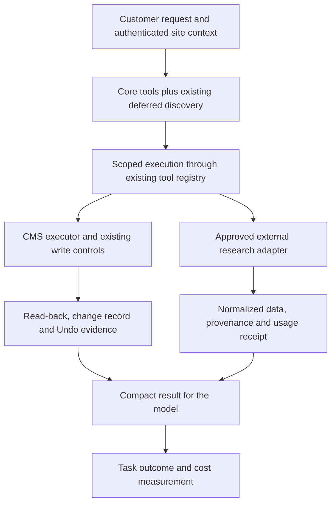

# Agent tool calling optimization — research and implementation plan

Current implementation follow-up: [agent usage and overlapping inventory reads across all three CMSs](2026-10-31-agent-tool-usage.md).

Local follow-up: [real daemon boot, local candidate deployment and Joomla/EmDash benchmarks](2026-10-30-agent-tool-calling-cross-cms.md).

Latest follow-up: [bounded multi-title search, real product-harness tests and repeat benchmark](2026-10-30-agent-tool-calling-batched-search.md). It reduces repeated inventory walks; provider transport failures limit overall latency/cost conclusions.

Follow-up: the detected lookup issue is addressed in the [lookup correction and repeat benchmark](2026-10-30-agent-tool-calling-lookup-improvement.md), which compares against this first optimized candidate.

Date: 2026-10-30. Latest status, 2026-10-31: three-CMS read and agent-usage improvements implemented and benchmarked locally; full customer-task acceptance, including writes and Undo, remains pending.

Research deliverable: this Markdown plan. Implementation now includes native discovery/read optimizations, measurement tooling and regression coverage. See the [implementation evidence and remaining work](2026-10-30-agent-tool-calling-optimization-results.md). A later user-authorized disposable WordPress experiment now includes real DeepSeek calls; see the [live before/after benchmark](2026-10-30-agent-tool-calling-live-benchmark.md). The local candidate and three-CMS follow-up are recorded above. Production deployment and production experiments remain unperformed.

## 1. Recommendation

Prioritize the tool layer: reduce unnecessary model round trips, expose the right capability at the right time, return only useful evidence, and make execution predictable. Measure improvement by verified customer outcomes and total cost per successful task.

The claim that models no longer matter is too strong. Models still differ in planning, argument construction, recovery and visual judgment. First hold the model fixed to isolate tool improvements; then test whether the improved tools let a cheaper model achieve the required quality.

For Tracy, the recommended sequence is:

1. Establish a reproducible task benchmark and fill telemetry gaps.
2. Improve the largest measured sources of repeated calls, oversized results and avoidable refusals.
3. Extend existing deferred loading with capability metadata and focused examples.
4. Package repeated workflows using existing scoped tools and the existing scheduler.
5. Compare external providers for narrow research capabilities, reusing the Monid integration already on develop.
6. Evaluate programmatic tool calling only after providing a properly isolated runtime.

External tool marketplaces and efficient tool execution solve different problems. Buying more tools can expand research coverage; it does not automatically reduce the cost of editing a footer or make an agent choose the correct CMS operation.

## 2. Research scope and confidence

Read the two supplied websites, their public technical documentation, Anthropic's engineering material, and Tracy's tool/runtime/measurement code. Inspected local checkout `6b8b9f40a19f9a00e530ff143927087b54d5e9b3`, fetched `origin/develop` at `76e7f114fa4ce6ac2e1b5b9d1c3ff9857c90c14e`, and examined relevant differences with `git show`. The inspected tool core has no differences between those two revisions; develop adds the Monid research integration described below. The harness submodule is `626ef50d882b24e25c1675899a67ebfa00f2689a` in both.

Open PR searches for tools and harness found no dedicated tool calling optimization line. PR [151](https://github.com/TracyHQ/tracy/pull/151) changes WordPress build filling and overlaps any build workflow optimization. Coordinate with that work before changing build helpers. Recheck develop and open PRs before implementation.

Evidence labels throughout this plan:

- **Observed:** supported by inspected repository code or public API documentation.
- **Vendor claim:** catalog counts, advertised pricing, reliability or performance reported by a vendor; not independently benchmarked here.
- **Proposal:** work and acceptance targets to validate, not measured improvements.

No current production latency, task success or dollar savings were measured. Historical figures in code comments explain existing design choices; they are not a new baseline.

## 3. What the supplied services teach us

| Service | Observed interface and vendor positioning | Useful for Tracy | Decision |
| --- | --- | --- | --- |
| Monid | Advertises 2,800+ tools and 71 categories with usage pricing. Its documented API separates discovery, endpoint inspection and execution. Inspection includes schema and pricing; runs have status/result retrieval. | Obtain external research data through a small integration surface; compare providers by task. | Reuse the develop integration first. Test more routes only when an actual research gap justifies them. |
| treg | Advertises 4,000+ endpoints and 121 providers. Documents search/get/call, server-side credentials, provider routing for specific capabilities, usage attribution and budgets. Public repository offers a self-hosting path. | Study capability discovery, provider comparison, cost attribution and budget enforcement; trial a narrow research adapter. | Candidate for comparison with direct providers and Monid. No recommendation to adopt its whole catalog yet. |

Sources: [Monid positioning](https://monid.ai/openrouter-for-agent-tools), [Monid API](https://monid.ai/docs/api/overview), [discovery](https://monid.ai/docs/api/discover), [inspection](https://monid.ai/docs/api/inspect), [integration options](https://monid.ai/docs/integrations/overview), [treg overview](https://treg.to/), [agent interface](https://treg.to/llms.txt), [product integration](https://treg.to/integrate.md), [repository](https://github.com/superdesigndev/treg).

The transferable pattern is **discover capability → inspect contract → execute with scope and budget → retain a receipt**. Common operations should retain a direct path so discovery does not add two model turns to every simple edit. Unknown or rare external capabilities benefit more from search.

Neither a shared credential nor a catalog establishes Tracy's per-site permissions. Research data may come from a gateway, while CMS changes continue through Tracy's existing scoped executors, change records and Undo.

### Engineering evidence beyond the marketplaces

Anthropic describes three complementary techniques: discovering tool definitions when needed, orchestrating calls in code, and supplying concrete usage examples. Its MCP article explains why intermediate datasets should be transformed outside model context when possible. These support testing discovery and execution design separately. Published savings belong to their workloads; this plan does not transfer them to Tracy.

Sources: [Advanced tool use](https://www.anthropic.com/research/advanced-tool-use), [Code execution with MCP](https://www.anthropic.com/research/code-execution-with-mcp).

## 4. Tracy already has much of the foundation

Paths in this section are relative to the repository root. Monid entries marked **develop** must be read from the fetched revision until the implementation branch includes them.

| Mechanism | Evidence | Implication for the plan |
| --- | --- | --- |
| Deferred tools | `packages/tools/tracy-site-tools/src/host/deferred-tools.mjs` | Brand/design/build tools are already released by deterministic triggers, including dependencies and resumed sessions. Extend this mechanism; do not add competing lazy loading. |
| Stable cached prefix | Same module; `packages/tools/tracy-site-tools/src/host/index.ts` | Keep previously exposed tools available. DeepSeek supports addition-only updates; other routes can start a new cache series when tools change. Measure each adapter. |
| Platform-specific surface | `packages/tools/tracy-site-tools/src/host/surface.mjs` | Tools already expose a platform-specific action set. Dynamic schema generation is presentation; executor checks remain authoritative. |
| Schema budgets | `scripts/test/tool-schema-budget.test.mjs` | Existing budgets cover selected tools. Extend coverage and measure complete request schemas. |
| Compact responses | `packages/tools/tracy-site-tools/src/host/read-compact.mjs`, `site-call.mjs` | Prefer summaries and selective retrieval; retain exact data needed for writes and read-back. |
| Output spill | `packages/tools/tracy-subprocess-docker/src/output-bound.mjs` | Bash already saves large outputs and gives a locator. Reuse the pattern instead of silently cutting more text. |
| Parallel execution | `vendor/tracy/deepseek-harness/packages/core/agent-loop/src/tool-calls.ts`, `packages/tools/tracy-site-tools/src/host/site-context.mjs` | There is already a bounded scheduler with exclusive barriers. Improve safe classifications and model batching. |
| Inspect caching and deduplication | `packages/tools/tracy-site-tools/src/host/call-memory.mjs`, `site-call.mjs` | Existing actor/session/site/turn scope and generation invalidation protect freshness. Avoid a global result cache. |
| Recovery and interrupted writes | `site-call.mjs`, `packages/tools/tracy-site-tools/src/host/stopped-writes.mjs` | Preserve replay rules and unknown outcomes. A stopped or timed-out call may already have written. |
| Measurement | `scripts/agent-turn-cost.mjs`, `scripts/measure/session-metrics.mjs`, `scripts/measure/bench-profile.mjs` | Extend existing event readers and benchmark transport. |
| External capability routing and spend controls | **develop:** `packages/wo/website-opportunities/domain/capabilities.mjs`, `src/wo-settings.js`, `src/cost-ledger.js` | Research already has operator provider order and reserve/settle accounting. Keep its catalog and ledger authoritative for that domain. |
| Monid Google reviews | **develop:** `packages/wo/website-opportunities/src/google-maps-monid.js`, `src/google-maps-monid-research.js`, `test/google-maps-monid.test.mjs` | Already pins a reviews route, bounds polling, normalizes provenance and integrates charging. Do not propose a duplicate initial Monid integration. |

Two constraints change the implementation choice:

1. `surface.mjs` records a previous closed schema union adding about **1,378 tokens per step** without strict decoding benefits. Start with on-demand action help and examples. Do not expand every action into a large always-present schema.
2. `packages/fleet/tracy-fleet-operation/dsh/profile/cordis.patch.yml` explicitly disables `ptc-runtime` and pins `tools.mode: native`. The existing PTC runtime would execute model code in the dsh container holding the Docker socket. A flag change is not a viable PTC experiment.

## 5. Target execution design

Use existing action definitions as the source for local capabilities. Research provider definitions remain in the WO capability catalog. An adapter may translate between these domains; do not create a second manually maintained catalog of either one.

Minimum metadata, added incrementally where a measured gap needs it:

- Stable capability/action ID, contract version and supported surface.
- Input contract reference, short purpose and one or two examples loaded on demand.
- Effect classification and replay behavior; transport method alone does not establish safety.
- Resource class, concurrency eligibility and exclusive requirements.
- Deadline/recovery behavior, output policy, revision requirements and invalidation hooks.
- For paid external operations: normalized result shape, provenance, estimate, settlement source and supported recovery identifiers.

The host supplies site, actor, session and turn identity. The model cannot assign a different customer, choose an unrestricted URL, set billing attribution or increase spending limits.

## 6. Work packages

Estimates are engineering days for one implementer with review and usable local fixtures. They exclude CI queues, external account setup and deployment scheduling. Re-estimate after the baseline. Work on one optimization branch/PR; keep the optional isolated-runtime experiment separate because it changes the execution boundary.

### P0 — Baseline and failure taxonomy: 2–3 days

**Owner:** runtime engineer; independent reviewer owns task verification.

- [ ] Inventory actual visible tool names, schema sizes, tool hashes and deferred additions for each supported platform and model route.
- [ ] Extend existing measurement output with missing fields: discovery attempts/hits/misses, input validation failures, per-action result size, cache hit/deduplication, retries at every layer, and queue/lease/execution/network timing where observable.
- [ ] Join existing model usage and research ledger records by stable task/call identifiers. Add events only where the join lacks evidence; redact arguments and customer content by default.
- [ ] Build the paired benchmark described in section 7 using existing bench tooling. Print active and inactive plugins so missing site-tools cannot produce a false success.
- [ ] Publish a ranked breakdown of time, model steps, context growth and recovery loops. Select the first two optimizations from that evidence.

**Files:** `scripts/agent-turn-cost.mjs`, `scripts/measure/session-metrics.mjs`, `scripts/measure/bench-profile.mjs`; relevant lifecycle hooks in site-tools only if needed.

**Done:** every result identifies its code/image/model/fixture; verified outcomes join to usage; missing prices or spans appear as unknown. No estimated dollar savings are presented as measured.

### P1 — Reduce unnecessary work: 3–5 days

**Owner:** tools engineer. Depends on P0.

- [ ] Optimize the two largest measured causes of waste. Candidate targets include repeated discovery reads, large inventories and repeated argument corrections.
- [ ] Add narrow field selection, filtering or pagination to the affected existing actions. Return identifiers, revisions, relevant matches and continuation information before full bodies.
- [ ] Preserve retrievable full data and opaque locators bound to the current actor/site. Never construct replacement content from a truncated source line.
- [ ] Batch independent reads in one model step through the existing scheduler. Preserve dependencies, ordered commits, cancellation and exclusive barriers.
- [ ] Retain exclusive handling for `page.text`, `page.look` and `db.dump` unless a resource-specific experiment proves a change safe. `page.text` already has internal fan-out; nested parallelism must share a bounded budget.
- [ ] Improve high-frequency recoverable errors with machine-readable code, offending field and a concrete supported next action. Separate protective permission refusals from mistakes to optimize away.
- [ ] Extend current call-memory rules for a specific demonstrated duplicate, if needed. Recheck authorization before serving a hit; invalidate on all relevant writes and reject reads that completed across an invalidation.

**Files:** `read-compact.mjs`, `site-call.mjs`, `site-context.mjs`, `call-memory.mjs`, `output-bound.mjs` as selected by evidence.

**Done:** paired runs meet the performance targets in section 8, without additional lost evidence, stale content, permission bypass or duplicate writes.

### P2 — Capability discovery and contract quality: 3–4 days

**Owner:** tools engineer with model adapter review. Depends on P0; can overlap later P1 tasks after the metric contract settles.

- [ ] Derive metadata from current action definitions and surface rules; add a consistency test for presentation versus execution support.
- [ ] Keep frequent edit capabilities available immediately. Extend existing deferral only for measured low-use tool groups with reliable recovery triggers.
- [ ] Expose action-specific help/schema/examples through an existing inspection mechanism if suitable. Introduce a small discovery tool only if no current mechanism can serve the need.
- [ ] Return a small, ranked, permission-filtered candidate set. Include a cheap way to broaden retrieval; measure wrong/no-match results in all eight interface languages.
- [ ] Preserve transitive tool dependencies, open builds, resumed sessions, instructions naming tools and monotonic additions. Unrelated reads must not unlock an entire catalog.
- [ ] Keep deterministic runtime validation even where an adapter supports strict arguments. Measure schema overhead and argument correctness together.
- [ ] Compare direct invocation versus discovery for short tasks. Reject a discovery change that saves schema tokens but adds more overall latency or cost.

**Files:** `deferred-tools.mjs`, `surface.mjs`, site-tools registration hooks, `scripts/test/tool-schema-budget.test.mjs`, existing deferral tests.

**Done:** core tasks incur no mandatory extra discovery step; rare-task discovery stays reachable; cache behavior is verified per adapter; argument error rate improves or remains stable.

### P3 — Reusable native workflows: 3–5 days

**Owner:** CMS tools engineer. Depends on P1 findings and P2 contracts; coordinate build changes with PR 151.

- [ ] Select at most two repeated workflows from baseline traces: for example, finding a footer contact field and changing it, or updating the same known phrase on several selected pages.
- [ ] Implement bounded orchestration behind existing tools: locate exact targets → read current revisions → write through the existing executor → read back → return granular receipts.
- [ ] Keep ambiguous editorial decisions with the model. Use deterministic code for pagination, exact matching, filtering and result aggregation.
- [ ] Preserve per-item status and identifiers for partial completion. Do not label a batch atomic unless its underlying transaction actually is atomic.
- [ ] Keep writes serialized where dependencies or site state demand it. Each nested operation retains authorization, write readiness, lease behavior, auditing and Undo semantics.
- [ ] On timeout or Stop, reconcile the operation identifier and read back before deciding whether another write is needed.

**Done:** fewer model round trips for those workflows, exact requested changes, no unrelated edits, complete change history and working Undo. A shortcut that bypasses Apply or the EmDash write path fails acceptance.

### P4 — External provider comparison: 2–4 days, optional

**Owner:** research integration engineer. Depends on P0 cost accounting; useful only for measured coverage, quality or price gaps.

- [ ] Start with the Monid Google reviews adapter already on develop and existing WO provider-order settings. Use its current behavior as one comparison arm.
- [ ] Choose one further capability with demand, such as public page extraction or search. Compare current direct provider, Monid and treg where equivalent routes exist.
- [ ] Check semantic equivalence before price: inputs, language/location, required fields, freshness, result completeness, attribution and permitted downstream use. Pin provider/route during the comparison.
- [ ] Implement only narrow adapters with normalized outputs. Search catalog metadata when onboarding a route, then cache its versioned contract; avoid re-discovering the same known endpoint on every job.
- [ ] Reuse reserve-before-send and settle-after-response in `cost-ledger.js`. Unknown outcomes retain their reservation until reconciled; cheap estimated list prices are not proof of settled cost.
- [ ] Keep billing attribution server-assigned. Account for per-result charges, limits, pagination, retries and asynchronous jobs. Do not silently reinterpret a missing charge as zero.
- [ ] Admit provider fallback only for semantically interchangeable reads with budget remaining. Never fail over a possibly accepted paid generation or site mutation blindly.
- [ ] Keep an operator-pinned provider order and a rollback to the previous order. Report gateway downtime separately from upstream provider downtime.

**Files:** existing WO capability catalog, `wo-settings.js`, `cost-ledger.js`, `cost-prices.js`, provider-specific adapters and their tests. Do not expose a generic authenticated proxy to the model.

**Done:** a comparison report proves a quality/coverage benefit or lower actual cost per usable result. Otherwise keep current providers. Catalog size alone is not acceptance evidence.

### P5 — Isolated programmatic tool calling: 5–10 days, optional experiment

**Owner:** harness/runtime engineer plus independent boundary reviewer. Starts after native improvements; not a prerequisite for shipping P1–P3.

- [ ] Review the harness fork ledger and current PTC implementation before designing an extension. Reuse nested call dispatch, scheduler and event semantics.
- [ ] Provide a runtime isolated from the dsh process, Docker socket, host mounts and credentials. Neither an in-process JavaScript VM nor a subprocess in the privileged container is sufficient isolation.
- [ ] Design an authenticated capability bridge binding each run to its original site, actor and turn. Recheck current permissions on every nested call; do not provide an unrestricted network proxy.
- [ ] Apply CPU, memory, wall-clock, output and nested-call limits. Bound concurrency by shared resource pools and propagate cancellation and uncertain outcomes.
- [ ] Start with read/filter/aggregate tasks on disposable fixtures. Preserve full nested-call audit records while returning a bounded outer result to the model.
- [ ] Compare native calls, P3 workflows and isolated PTC on the same bulk-read tasks. Include code-generation failures and sandbox startup in cost and latency.
- [ ] Before any write trial, prove revoked-seat handling, cross-site denial, revision checks, write receipts, Undo and interruption recovery through the bridge.

**Architecture gate:** keep the fleet's current `ptc-runtime` prohibition in place. A later design review must establish how an isolated implementation is deployed and enforced; only then propose any fleet invariant change. Update `SYSTEM.md` and relevant boundary tests together, following the harness fork/submodule process.

**Done:** isolated PTC materially beats native workflows on its target workload and passes boundary acceptance. An inconclusive result leaves native mode in use.

## 7. Benchmark protocol

Use disposable WordPress, Joomla and EmDash sites. Restore files and database to an identical snapshot before each write trial. Observe the visible result and persisted state independently of the model's final answer.

Initial task matrix: 12 task families × 3 CMSs × 2 arms × 3 repeats = **216 runs per experiment**. This is an exploratory comparison, not enough evidence for every tail-latency or quality claim. Add repetitions to noisy and critical slices. Record inapplicable operations explicitly rather than inventing cross-platform equivalents.

| Task family | What must be verified |
| --- | --- |
| Find a page or phrase | Correct target and source evidence |
| Change a footer phone number | Correct shared location and no unrelated changes |
| Change a page heading | Exact requested text and preserved structure |
| Change a menu label | Correct menu/item and retained destination |
| Find and replace an image | Correct asset, attribution and layout |
| Multi-page text update | Exact target set and per-item outcomes |
| Change visible form wording | Preserved fields, recipients and behavior |
| Small style change | Actual rendered result and no unrelated style regression |
| Undo a previous change | Restored content/state and recorded action |
| Follow-up after a write | Fresh reads and correct revisions |
| Rare design/build capability | Discovery, dependencies and open-build recovery |
| External research | Provenance, required fields, freshness and usable results |

Run a separate deterministic fault matrix: revoked seat, Viewer write, cross-site path/locator, stale revision, simultaneous edits, invalid arguments, rate limiting, cancellation before send, cancellation after send, lost write response, cache invalidation, provider outage and concurrent budget reservations. Some are expected refusals; score whether the behavior is correct.

Freeze and record repository commit, image digest, harness/CMS versions, exact model and provider route, reasoning effort, effective preset, tool/schema hashes, prompt/skill revision, fixture revision, cache state and background load. Interleave baseline/candidate order. Use identical task-specific cold/warm conditions and report those strata separately.

Primary experiment keeps the model fixed. After a winning tool change, repeat a representative subset with a cheaper model and a stronger model to measure interaction. Do not claim model independence from one model's result.

Reuse `bench-profile.mjs` and `agent-turn-cost.mjs`. Real-model experiments incur spend and variance; do not turn their timing thresholds into deterministic merge gates. This planning task did not itself authorize launching paid experiments. The subsequent explicit request to execute the benchmark authorized the focused live experiment documented in the linked report.

## 8. Metrics and acceptance

All thresholds below are **proposed targets**, not research findings.

| Metric | Definition | Proposed acceptance |
| --- | --- | --- |
| Verified task success | Requested result on correct site, independently checked | No credible quality regression; inspect failures individually and enlarge inconclusive samples |
| Boundary integrity | Site/actor fence, permission checks and secret isolation | Zero observed critical violations; required deterministic cases pass |
| Change integrity | Accurate Site changes, read-back and Undo for supported operations | All applicable acceptance cases pass |
| Cost per successful task | All attempt spend, including failures and retries, divided by verified successes | Aim for at least 20% improvement on the targeted task cohort |
| Customer latency | Request to verified completion, with failed/time-out rates alongside | Aim for at least 20% lower p50 on targeted cohort; p90 at most 10% worse |
| Model round trips | Steps per task, with calls per step and dependency structure | Fewer unnecessary steps; never maximize call density blindly |
| Context overhead | Schema/result tokens and cached versus uncached usage | Reduction must translate into task cost/latency or greater usable context |
| Discovery and recovery | Relevant capability found; correct next action after an error | No unreachable required tools or newly introduced repeated-error loops |

A candidate may ship for a material cost **or** latency benefit if quality and boundary requirements pass and the other primary metric stays acceptable. Predeclare the target cohort and thresholds before running; do not select favorable slices afterward. If the sample cannot establish the claim, report it as inconclusive.

Compute monetary cost using dated, route-specific rates for uncached input, cache reads, cache writes where billed, output/reasoning as billed, paid tools and attributable execution infrastructure. Normalize provider usage semantics before summing. `totalTokens` is not dollars; cached tokens are cheaper, not free. Missing usage or settlement is unknown, with reserved ceiling shown separately.

For latency, report model time, union of tool execution intervals, queue/lease waits, verification/closure tail and time to first useful action. Overlapping calls cannot be summed as customer wall-clock time, and component percentiles cannot simply be added together.

## 9. Rollout, review and rollback

Before implementation, create the working branch from freshly fetched `origin/develop`. Read the nearest instructions and relevant skills for each actual code area. Keep core optimization changes in one line of work; do not mix the optional execution-boundary experiment into it.

1. Run deterministic contract and failure-injection tests, then the paired disposable-site benchmark.
2. Rebuild affected committed plugin bundles. Add a new English journal entry and regression case/evidence for implementation changes.
3. Update `SYSTEM.md` whenever request, write, data or runtime boundaries change. Preserve the same web and desktop behavior.
4. Before opening/readying a draft PR, follow `pr-merge`, read the gates reference, merge current develop and rerun required checks. Never weaken a gate to enable a runtime experiment.
5. After development acceptance and deployment authorization, rebuild/deploy the relevant dsh image; web-side adapters also need their service image. Record deployed digests.
6. Start with team-owned test sites and existing operator provider controls. Expand only when task correctness, cost and p90 remain acceptable.
7. Roll back a tool change through the prior image; roll back a research route through existing provider-order settings. Preserve receipts and reconcile in-flight work before retrying it.

Required review scenarios: multilingual discovery, resumed sessions, open builds, partial batches, stale reads, revoked permission, uncertain writes, concurrent paid calls and full Undo. Performance does not waive any of these.

## 10. Delivery schedule and decision points

| Milestone | Scope | Estimated effort | Decision |
| --- | --- | --- | --- |
| M0 | P0 baseline | 2–3 days | Identify dominant measured bottlenecks |
| M1 | P1 targeted improvements | 3–5 days | Ship only measured wins with intact correctness |
| M2 | P2 discovery/contracts | 3–4 days | Expand only when retrieval beats existing direct paths |
| M3 | P3 native workflows | 3–5 days | Retain only helpers that remove meaningful round trips |
| M4, optional | P4 provider comparison | 2–4 days | Adopt a route only on quality/coverage/cost evidence |
| M5, optional | P5 isolated PTC | 5–10 days | Separate architecture and rollout decision |

The core P0–P3 plan totals **11–17 engineering days** for one implementer. Two engineers can overlap contract work and benchmark analysis after P0, but acceptance and shared executor changes remain dependency-bound. Optional P4/P5 add 7–14 days if both are justified.

First useful checkpoint: after M0, produce a baseline table and the two selected bottlenecks. If model latency dominates, focus on round trips and workflows. If tool waits dominate, focus on resource contention and backend paths. If external invoices dominate, prioritize P4. If verified quality is low, fix targeting/contracts before reducing spend.

## 11. Evidence still needed

- Current task distribution, correctness rate and latency/cost by CMS and operation.
- Actual model route prices and normalized usage semantics, including cache behavior.
- Production availability and settled costs of candidate Monid/treg routes; website statements alone cannot establish these.
- Whether existing workflow shortcuts already cover the selected baseline tasks after incoming develop changes.
- Whether isolated PTC beats bounded native orchestration enough to justify another runtime boundary.

These are measurement tasks in the plan. They do not prevent the initial inventory and deterministic contract work, and they must not be replaced with invented baseline numbers.

## 12. Next iteration: tool implementation and agent usage across all three CMSs

The user extended the scope to WordPress, Joomla and EmDash, including how the agent chooses and uses tools. Optimize verified task completion through both the executor and the model-facing contract. A faster executor alone does not establish an agent improvement; a scripted tool sequence does not establish that a model chooses that sequence naturally.

### Work list and ordering

| Priority | Tool implementation | Agent behavior to improve | Required evidence |
| --- | --- | --- | --- |
| P0 | Record scheduler wait, relay duration, each CMS request, pagination and result processing; rerun without competing repository audits | Record the actual action/argument sequence, dependent steps, repeated reads and refusal recovery | Same fixed model/route and task set across all three CMSs; explain Joomla's observed regression before choosing a fix |
| P1 | Preserve existing direct paths and exact opaque IDs | Choose the shortest supported path: known URL uses page lookup; named titles use search; quoted replacement uses the existing replacement workflow when applicable | Natural-language tasks with no prescribed calls; independent verification of target identity and persisted changes |
| P1 | Keep bounded OR search and measure sharing of concurrent equivalent inventory reads | Group independent title queries into one bounded OR search; keep dependent calls ordered | Fewer backend reads and unnecessary calls, complete results, no cross-site/seat/locale reuse |
| P1 | Measure source filtering and safe pagination per CMS | Request the relevant locale/type and follow continuation only while required evidence is missing | Multilingual/shared-content cases, complete inventory controls, no fabricated IDs or omitted matches |
| P1 | Return sufficient result-local evidence and accurate write receipts | Reuse evidence already obtained during the task; avoid rereading confirmed writes; refresh when revision, permission or relevant state changes | Concurrent-edit, stale-read, receipt and exact Undo controls |
| P2 | Preserve structured refusal codes and actionable next steps | Correct invalid arguments, disambiguate targets and follow the supported recovery; do not repeat an unchanged failing call or bypass a refusal | Ambiguous/missing target, unsupported search, revoked seat, Viewer write and cross-site refusal cases |
| P2 | Record request attempts and uncertain write outcomes | Retry eligible transient reads with bounded attempts; reconcile an uncertain write through its existing receipt/status path before another write | Provider outage, rate limit, cancellation and lost write-response cases; no duplicated write |
| P2 | Compact results while retaining IDs, paths, continuation and refusal evidence | End the task when its requested outcome is verified; report a partial result when completion is unproven | Success rate, completion latency, token usage and number of unnecessary follow-up calls |

Use the nearest existing Tracy tool description, preset or skill as the source of guidance. Inspect which instructions actually reach the model before editing them. Prefer concise task-to-action examples and result-local recovery instructions over a second global prompt policy. Keep the shared harness unchanged unless measurements demonstrate a harness defect and its wider regression coverage is available.

CMS-specific targets remain explicit:

- WordPress: measure remaining discovery reads and redundant model-selected calls; preserve the distinction between native numeric IDs and opaque Content API IDs, exact writes and Undo.
- Joomla: reproduce and explain the slower OR-search timing; measure listing pagination and source search before selecting concurrency or filtering changes. Fewer reads alone is not acceptance.
- EmDash: measure locale/type filtering before traversing the observed 2,027 sources; preserve shared content, language fallback, identity and route behavior. Reader changes have a wider scope than site-tools and require their own before/after controls within this line of work.

### Benchmark tool changes separately from agent guidance

Freeze the current candidate as the new baseline, including its effective instructions, schemas and runtime bundle. For each CMS, compare four compatible arms:

| Arm | Executor | Agent guidance | Purpose |
| --- | --- | --- | --- |
| A | Baseline | Baseline | Reference |
| B | Improved | Baseline | Isolate executor benefit |
| C | Baseline | Improved | Isolate agent usage benefit |
| D | Improved | Improved | Measure the combined customer outcome |

Guidance-only arm C must use capabilities already supported by the baseline. If a behavior needs a new capability, record that dependency and use a compatible comparison instead of pretending the two factors are independent. Record effective prompt/tool-description hashes and model request traces for every arm.

Use natural customer requests for single-title, multiple-title, known-URL, multilingual, ambiguous/missing target, quoted replacement and multi-record tasks. Include a case where a write receipt completes the request and a case where independent verification or recovery is required. Do not reveal the expected action sequence to the measured model. Scripted AgentLoop cases remain separate deterministic integration evidence.

Hold model, provider route, reasoning settings, CMS data and cache conditions fixed; balance arm order and separate benchmark execution from broad audits. Keep every attempt, provider failure and unknown charge. Independently verify correct site/record/locale, exact persisted content, unrelated-content integrity, receipts and Undo for writes.

Report verified success, median/p90 task latency, time to first useful action, model requests, tool calls, backend reads, redundant calls, refusal loops, result/input tokens and cost per verified success where usage is available. Classify redundancy against the task's actual dependencies: a required stale-state refresh or safety check is not waste. No latency win is accepted by dropping required verification, permissions, provenance or Undo. These are planned measurements; no new improvement is claimed by this scope update.
