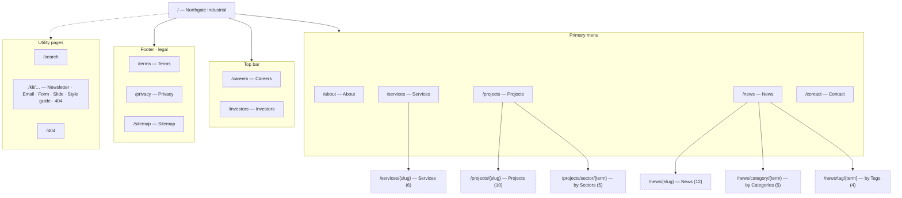
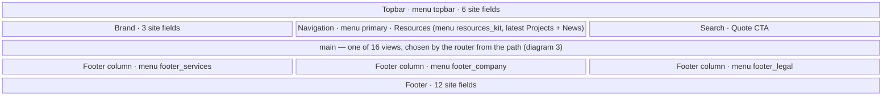
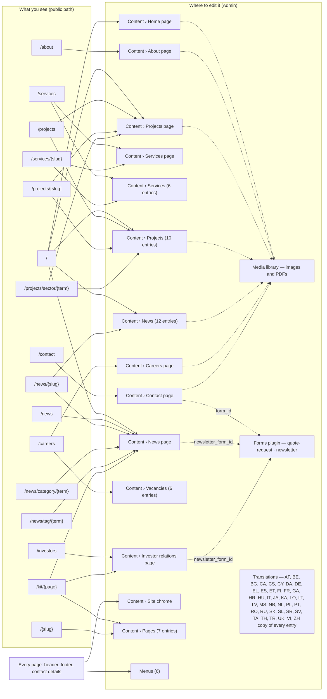
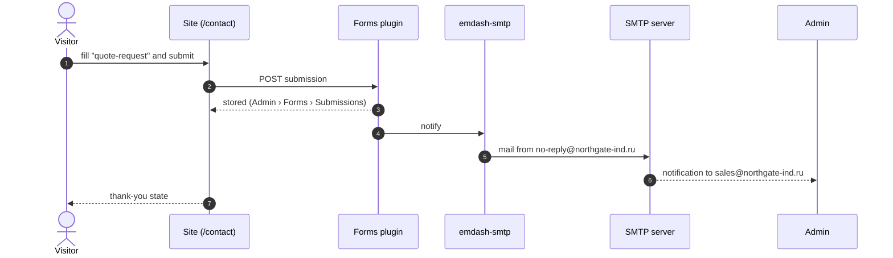

# Tracy Business (`@tracy/emdash-theme-business`)

**Tracy Business** (template id `tracy-business`) is Tracy's EmDash template for company websites.
Its demo content is the **Northgate Industrial** design: an industrial general contractor site in
English and Russian — home, about, services (+ detail), projects (+ sector archives, detail), news
(+ categories, tags, articles), careers (+ vacancies), investor relations, contact (real form),
search, marketing kit (newsletter/email/form/slides/style guide), legal pages, sitemap, 404.
Identity, locales, form bindings, mail defaults and the SEO audit policy live in
`template.config.json`; every tool reads that file, none of them hardcodes the demo customer.

Built with **EmDash 0.38** on **Astro 7** (SSR, Node adapter), **Tailwind CSS 4** and **shadcn/ui**.
Every piece of copy, every image, menu and business figure is editable in the EmDash admin; the
layout is the template's. Design source: `vendor/joomla/html/tracy_business/` (see `PROVENANCE.md`).
Build record and decisions: `tasks/emdash-northgate/` in the TCH repo (not shipped with the package).

## Requirements

Node ≥ 22.16 (24.x used), pnpm 11 via corepack. Everything else is pinned in `package.json` +
`pnpm-lock.yaml`. Optional for local mail testing: Docker (Mailpit).

## Install and run (development)

```bash
pnpm install --frozen-lockfile
pnpm exec astro dev --port 4360 --host 127.0.0.1     # Astro 7 daemon: `astro dev status|logs|stop`
tools/bootstrap-site.sh http://127.0.0.1:4360 ./data # first-run setup, admin + agent token, schema/content/media/forms
```

`bootstrap-site.sh` is safe to rerun: it never passes `--force`. Content written by the first-run
setup is adopted (recorded, not rewritten) because it equals the seed; anything an editor changed
or left as a draft is kept and reported (exit 3 = entries need a decision: `seed-apply adopt` after
review, or an explicit `--force`).

The site answers at `http://127.0.0.1:4360` (EN) and at `/<locale>` for the other 39; admin at `/_emdash/admin`
(development only: `/_emdash/api/setup/dev-bypass?redirect=/_emdash/admin` signs in as a dev admin).
The agent token lands in `data/tracy-agent.token` (mode 600, gitignored) and is what
`tools/seed-apply.mjs` uses. Every tool takes the site origin explicitly (`--site`, or the first
argument) — there is no implicit localhost site.

## Install and run (built)

```bash
pnpm install --frozen-lockfile
pnpm build
HOST=127.0.0.1 PORT=4361 node dist/server/entry.mjs &
tools/bootstrap-site.sh http://127.0.0.1:4361 ./data
```

`tools/clean-install.sh <dir> <port>` does all of that from a fresh copy of this directory — the
proof that the template rebuilds from what is committed. It only fills a new or empty directory
(never a symlink, never inside this tree or another project, never a busy port) and checks all of
that before writing anything. It starts the server detached and prints no PID: to find or stop it,
`lsof -ti tcp:<port> -sTCP:LISTEN` (and `kill` that pid); `server.log` in the new directory is its log.

## Sign in to the admin on a built site

A build has no dev bypass and passkeys need a real authenticator, so the door for a person or a
script is the **email link**. Two admins exist after bootstrap (`tools/mint-admin.cjs`): the
resident agent `tracy-agent@tracy.ai` (`TRACY_AGENT_EMAIL`) and, when `TRACY_OWNER_EMAIL` was set
for the bootstrap, the site owner. Mail must reach somewhere first — locally, Mailpit:

```bash
docker run -d --name ng-mailpit -p 127.0.0.1:1025:1025 -p 127.0.0.1:8025:8025 axllent/mailpit
node tools/configure-smtp.mjs --site http://127.0.0.1:4361 --token-file data/tracy-agent.token --host 127.0.0.1 --port 1025
node tools/admin-session.mjs --site http://127.0.0.1:4361 --email tracy-agent@tracy.ai --out admin-state.json
```

`admin-session.mjs` requests the link, reads it from Mailpit, follows it, dismisses the first-visit
welcome dialog (its backdrop swallows every later click) and saves a Playwright storage state that
`admin-roundtrip.mjs`, `forms-check.mjs` and `qa.mjs --storage-state` reuse. In a browser, open
`/_emdash/admin/login` → *Sign in with email link* → the same address, then read Mailpit at
`http://127.0.0.1:8025`.

Admin entry URLs are `/_emdash/admin/content/<collection>/<id>?locale=<l>` where `<id>` is the
entry's ULID (not its slug): `GET /_emdash/api/content/<collection>/<slug>?locale=<l>` with
`Authorization: Bearer <data/tracy-agent.token>` and `X-EmDash-Request: 1` returns it as `data.item.id`
(the REST envelope is `{ success, data: { item, _rev } }`).
Field controls in the editor carry `id="field-<fieldName>"` (`field-lede`, `field-title`, …).
`admin-roundtrip.mjs` compares the public page's rendered text case-insensitively, so a field styled
`text-transform: uppercase` (eyebrows, badges) still proves the round trip. Mailpit may be shared with
other local sites: `admin-session.mjs` only reads messages to the given address newer than its own
request. `server.log` may show `Magic link send error: Hook timeout after 5000ms` while the mail
still arrives — the SMTP hook answers after EmDash's 5 s wait; the sign-in link is valid.

Crawl audit on a running site (asserts the canonical/hreflang/noindex/404 policy, fails on an
incomplete crawl): `node tools/audit.mjs http://127.0.0.1:<port> audit --config template.config.json`.

<!-- diagrams:start — generated by tools/diagrams.mjs, do not edit by hand -->

## Site at a glance

Five diagrams for whoever administers a site built from this template. They are generated from `seed/seed.json`, `template.config.json`, the router and the views by `node tools/diagrams.mjs` (`--check` in CI), so they describe the template as it is — regenerate after changing the schema, menus, routes or forms. Paths are shown for `en`; every other locale (`/af`, `/be`, `/bg`, `/ca`, `/cs`, `/cy`, `/da`, `/de`, `/el`, `/es`, `/et`, `/fi`, `/fr`, `/ga`, `/hr`, `/hu`, `/it`, `/ja`, `/ka`, `/lo`, `/lt`, `/lv`, `/ms`, `/nb`, `/nl`, `/pl`, `/pt`, `/ro`, `/ru`, `/sk`, `/sl`, `/sr`, `/sv`, `/ta`, `/th`, `/tr`, `/uk`, `/vi`, `/zh`) mirrors the same tree.

### 1. Site map

Which pages exist and how they hang together. Dashed nodes are generated from content (one page per entry or per term); the count is what the seed ships.



### 2. Page layout

Every page is the same frame around one view. The frame reads the **Site chrome** entry and the menus; the view reads its own collection (diagram 3).



Every field below lives in **Content › Site chrome**; the menus in **Menus**.

| Region | Site chrome fields |
|---|---|
| Topbar | `theme_dark_label`, `theme_light_label`, `topbar_phone`, `topbar_email`, `topbar_address`, `language_name` |
| Brand | `brand_name`, `brand_mark`, `brand_sub` |
| Navigation | `resources_label`, `kit_title`, `recent_projects_title`, `news_column_title`, `resources_all_label` |
| Actions | `quote_url`, `quote_label`, `search_button` |
| Footer | `brand_name`, `brand_mark`, `footer_text`, `footer_services_title`, `footer_company_title`, `footer_contact_title`, `hotline`, `sales_email`, `hours`, `footer_book_label`, `social`, `copyright` |

### 3. Where to edit what

Start from the page you are looking at; the arrow ends on the admin screen that holds its copy. Dotted arrows: images come from the media library, the two forms are wired by id, and each entry has a translation per locale.



### 4. Content model

Singletons hold a page's copy; lists hold entries with a slug. Crow's-foot lines are references (a home-page slot points at a project), taxonomies (a post has categories and tags) and the form bindings.

```mermaid
erDiagram
  home {
    kind singleton "Home page · /"
    int fields "32"
  }
  projects_page {
    kind singleton "Projects page · /projects"
    int fields "23"
  }
  projects {
    kind list "Projects · /projects/{slug}"
    int fields "20 · 10 entries"
  }
  news_page {
    kind singleton "News page · /news"
    int fields "26"
  }
  posts {
    kind list "News · /news/{slug}"
    int fields "14 · 12 entries"
  }
  vacancies {
    kind list "Vacancies"
    int fields "5 · 6 entries"
  }
  investors {
    kind singleton "Investor relations page · /investors"
    int fields "26"
  }
  contact {
    kind singleton "Contact page · /contact"
    int fields "17"
  }
  home }o--|| projects : "project_big"
  home }o--|| projects : "project_small_1"
  home }o--|| projects : "project_small_2"
  projects_page }o--|| projects : "featured_project"
  tax_category {
    taxonomy category "Categories: disclosures, engineering, projects, careers, company"
  }
  posts }o--o{ tax_category : "category"
  tax_tag {
    taxonomy tag "Tags: machine-foundations, structures, vibration, factory"
  }
  posts }o--o{ tax_tag : "tag"
  tax_sector {
    taxonomy sector "Sectors: production, logistics, energy, refurbishment, infrastructure"
  }
  projects }o--o{ tax_sector : "sector"
  tax_department {
    taxonomy department "Departments: site, design, estimating, office"
  }
  vacancies }o--o{ tax_department : "department"
  contact ||--|| form_quote_request : "form_id"
  news_page ||--|| form_newsletter : "newsletter_form_id"
  investors ||--|| form_newsletter : "newsletter_form_id"
```



Not in the picture because nothing points at them and they point at nothing: **Site chrome** (singleton, 47 fields), **About page** (singleton, 28 fields, `/about`), **Services page** (singleton, 17 fields, `/services`), **Services** (6 entries, 5 fields, `/services/{slug}`), **Careers page** (singleton, 22 fields, `/careers`), **Pages** (7 entries, 5 fields, `/{slug}`). Each is a self-contained page: its copy, images and repeaters are all its own fields.

### 5a. What happens when a visitor submits the quote form

Where a submission is stored and who gets mailed. SMTP is configured with `tools/configure-smtp.mjs`.



### 5b. Life of an edit

Saving never touches the public site; publishing does. Translations are separate copies with their own publish step.

```mermaid
stateDiagram-v2
  [*] --> Draft : editor saves (EN)
  Draft --> Draft : Save again
  Draft --> Published : Publish changes → Publish changes now
  Published --> Draft : edit again (public page keeps the published version)
  Published --> Translated_AF : Translations › Edit AF
  Published --> Translated_BE : Translations › Edit BE
  Published --> Translated_BG : Translations › Edit BG
  Published --> Translated_CA : Translations › Edit CA
  Published --> Translated_CS : Translations › Edit CS
  Published --> Translated_CY : Translations › Edit CY
  Published --> Translated_DA : Translations › Edit DA
  Published --> Translated_DE : Translations › Edit DE
  Published --> Translated_EL : Translations › Edit EL
  Published --> Translated_ES : Translations › Edit ES
  Published --> Translated_ET : Translations › Edit ET
  Published --> Translated_FI : Translations › Edit FI
  Published --> Translated_FR : Translations › Edit FR
  Published --> Translated_GA : Translations › Edit GA
  Published --> Translated_HR : Translations › Edit HR
  Published --> Translated_HU : Translations › Edit HU
  Published --> Translated_IT : Translations › Edit IT
  Published --> Translated_JA : Translations › Edit JA
  Published --> Translated_KA : Translations › Edit KA
  Published --> Translated_LO : Translations › Edit LO
  Published --> Translated_LT : Translations › Edit LT
  Published --> Translated_LV : Translations › Edit LV
  Published --> Translated_MS : Translations › Edit MS
  Published --> Translated_NB : Translations › Edit NB
  Published --> Translated_NL : Translations › Edit NL
  Published --> Translated_PL : Translations › Edit PL
  Published --> Translated_PT : Translations › Edit PT
  Published --> Translated_RO : Translations › Edit RO
  Published --> Translated_RU : Translations › Edit RU
  Published --> Translated_SK : Translations › Edit SK
  Published --> Translated_SL : Translations › Edit SL
  Published --> Translated_SR : Translations › Edit SR
  Published --> Translated_SV : Translations › Edit SV
  Published --> Translated_TA : Translations › Edit TA
  Published --> Translated_TH : Translations › Edit TH
  Published --> Translated_TR : Translations › Edit TR
  Published --> Translated_UK : Translations › Edit UK
  Published --> Translated_VI : Translations › Edit VI
  Published --> Translated_ZH : Translations › Edit ZH
  Translated_AF --> Published : publish the AF copy
  Translated_BE --> Published : publish the BE copy
  Translated_BG --> Published : publish the BG copy
  Translated_CA --> Published : publish the CA copy
  Translated_CS --> Published : publish the CS copy
  Translated_CY --> Published : publish the CY copy
  Translated_DA --> Published : publish the DA copy
  Translated_DE --> Published : publish the DE copy
  Translated_EL --> Published : publish the EL copy
  Translated_ES --> Published : publish the ES copy
  Translated_ET --> Published : publish the ET copy
  Translated_FI --> Published : publish the FI copy
  Translated_FR --> Published : publish the FR copy
  Translated_GA --> Published : publish the GA copy
  Translated_HR --> Published : publish the HR copy
  Translated_HU --> Published : publish the HU copy
  Translated_IT --> Published : publish the IT copy
  Translated_JA --> Published : publish the JA copy
  Translated_KA --> Published : publish the KA copy
  Translated_LO --> Published : publish the LO copy
  Translated_LT --> Published : publish the LT copy
  Translated_LV --> Published : publish the LV copy
  Translated_MS --> Published : publish the MS copy
  Translated_NB --> Published : publish the NB copy
  Translated_NL --> Published : publish the NL copy
  Translated_PL --> Published : publish the PL copy
  Translated_PT --> Published : publish the PT copy
  Translated_RO --> Published : publish the RO copy
  Translated_RU --> Published : publish the RU copy
  Translated_SK --> Published : publish the SK copy
  Translated_SL --> Published : publish the SL copy
  Translated_SR --> Published : publish the SR copy
  Translated_SV --> Published : publish the SV copy
  Translated_TA --> Published : publish the TA copy
  Translated_TH --> Published : publish the TH copy
  Translated_TR --> Published : publish the TR copy
  Translated_UK --> Published : publish the UK copy
  Translated_VI --> Published : publish the VI copy
  Translated_ZH --> Published : publish the ZH copy
  Published --> [*]
```



<!-- diagrams:end -->

## Where things live

| Path | What |
|---|---|
| `seed/seed.json` | schema (14 collections, taxonomies, menus, settings) + text content in 40 locales; generated by `tools/build-seed.mjs` from the extracted source data, validated with `tools/validate-seed.mjs` |
| `seed/media-map.json`, `seed/media/` | the 35 images/PDFs and the 98 fields they fill; uploaded by the importer (EmDash 0.37 seeds do not carry local files) |
| `tools/forms.json` | the two forms per locale (quote request, newsletter) for the Forms plugin |
| `template.config.json` | template identity (`id`, `label`, `version`), `locales`, `contentOrder`, form bindings, mail defaults, audit policy (indexable/noindex/404 patterns, canonical query keys, probes) |
| `tools/seed-apply.mjs` | importer/reconciler: `status · schema · adopt · content · media · forms · all`, `--dry-run`, `--force` (explicit only), exit 3 on conflicts; receipts in `data/seed-receipts.json`; media identity is EmDash's `sha1:` content hash; media/form repairs skip entries with a pending draft or an editor change |
| `tests/` | `pnpm test` — 63 kit regression tests (mock EmDash API + DE/FR fixture + mock site: clean-install refusals, adopt/editor/conflict/draft rules, media hash identity, backup/restore preflight, audit, contract, distribution, acceptance gate, receipts) plus this template's own (`media-url`, `public-origin`); ~2.5 min, most of it the browser gate |
| `tools/backup.sh`, `tools/restore.sh` | snapshot/restore `data/` + `uploads/` |
| `tools/configure-smtp.mjs` | point the `emdash-smtp` plugin at an SMTP server (local: Mailpit) and send a test |
| `tools/shoot.mjs`, `tools/audit.mjs`, `tools/interact.mjs` | screenshots; crawl audit that asserts the canonical/hreflang/noindex/404 policy from `template.config.json` and fails on an incomplete crawl; interaction checks |
| `tools/qa-contract.mjs`, `tools/qa.mjs`, `tools/qa-receipt.mjs`, `tools/distribution.mjs` | the acceptance gate: `qa.contract.json` (kept in the repo, not in the artifact) validated against the design folder; `qa.mjs --browser` runs pages × variants × states, the audit, artifact verification and receipt checks; `distribution.mjs pack/verify` makes and checks the artifact |
| `tools/admin-session.mjs`, `tools/admin-roundtrip.mjs`, `tools/forms-check.mjs`, `tools/recovery-check.mjs` | evidence for the review gates on a running site: sign in on a build, edit through the admin UI, submit the contact form, restart + backup/restore |
| `src/lib/hreflang.ts`, `src/lib/hreflang-plugin.ts` | the template decides hreflang alternates per page (translation routes, mirrored archive paths, `?page=` kept) and emits them through a small native EmDash plugin |
| `src/pages/[...path].astro` | one router for both locales; views in `src/views/` |
| `src/styles/tokens.css` | the design's tokens (light + dark) mapped onto Tailwind and shadcn |
| `src/components/ui/` | shadcn primitives (committed source, `PROVENANCE.md`) |
| `artifact.json` | manifest for a later integration (template id/label from `template.config.json`, package, pins, locales, env names, entrypoints, checksums) — `node tools/artifact.mjs` |

## Editing content

Admin → **Site chrome / Home page / About page / …** hold each page's copy with labelled fields;
**Services / Projects / News / Vacancies / Pages** are the lists. Images are picked from the media
library. Save writes a draft; **Publish changes → Publish changes now** puts it on the public site.
Translations: sidebar → Translations → Edit RU.

## Updating the template on a live site

```bash
# from the site directory; --site defaults to http://127.0.0.1:4360 (or $TEMPLATE_SITE) — always pass it explicitly
S="--site http://127.0.0.1:4361 --token-file data/tracy-agent.token --receipts data/seed-receipts.json"
node tools/seed-apply.mjs status $S            # what differs (same / changed / editor / conflicts / untracked / drafts)
node tools/seed-apply.mjs schema $S            # new/changed fields and collection settings
node tools/seed-apply.mjs content $S --dry-run # plan: same / update / editor / adopt / conflict
node tools/seed-apply.mjs content $S           # applies updates; keeps editor-changed entries and drafts; exit 3 lists conflicts
node tools/seed-apply.mjs media $S && node tools/seed-apply.mjs forms $S
node tools/seed-apply.mjs adopt $S             # after review: claim entries whose public data equals the seed (never writes to the site)
```

`--force` resolves **conflicts** (seed changed and an editor changed the same entry) in the seed's favour;
entries an editor changed while the seed did not are still kept. `--force-all` also resets those.
`receipts.runs` records one entry per run with `finished: true` only when it completed.

Canonical URLs keep only `?page=N`; filters, search terms and tracking parameters are dropped. The
search page is `noindex`. Every indexable page carries one hreflang link per locale plus `x-default`.

Never run `emdash seed … --on-conflict update` on a site with editors: it rewrites content.

## Backup and restore

`tools/backup.sh [data] [uploads] [out]` snapshots SQLite (online backup), uploads, receipts and the
token into `backups/tracy-business-<stamp>.tgz`. `tools/restore.sh <archive> [data] [uploads]` — stop
the site first — reads and validates the whole archive (tar listing, `data/data.db`, SQLite opens)
before it moves the current state aside as `*.before-restore-<stamp>`; it refuses shallow or
dangerous target paths.

## Mail

Forms notify the address in `template.config.json → mail` (demo: `sales@northgate-ind.ru`) through
the `emdash-smtp` plugin. Locally:

```bash
docker run -d --name ng-mailpit -p 127.0.0.1:1025:1025 -p 127.0.0.1:8025:8025 axllent/mailpit
node tools/configure-smtp.mjs --site http://127.0.0.1:4361 --token-file data/tracy-agent.token --test sales@northgate-ind.ru   # Generic SMTP 127.0.0.1:1025, no auth
```

Production SMTP is configured in Admin → SMTP Providers (never from this repo). A local Mailpit
pass says nothing about production deliverability.

## Environment

See `.env.example`. Development needs nothing. A deployed site sets `EMDASH_ENCRYPTION_KEY`
(plugin secrets at rest) and `EMDASH_SITE_URL` (absolute URLs behind a proxy). `PORT` is whatever
you start the server with — the examples use 4360 for `astro dev` and 4361 for a built server, and
`clean-install.sh` takes the port as its argument. `TRACY_OWNER_EMAIL` / `TRACY_OWNER_NAME`, when
set for `bootstrap-site.sh`, seed the owner as an admin so their first email-link sign-in lands on
an account that already owns the site.

## Known limitations

Recorded during the build (the TCH repo keeps the evidence under `tasks/emdash-northgate/`; the
installed package carries only this summary): no file upload
on the contact form (plugin route limitation on 0.37), Terms/Privacy carry generic legal sample
copy written by Tracy (the source had no body; D32) — replace it with the customer's own text before
going live, reports/downloads without files render without links, some figures differ page to page
(kept as in the source).
